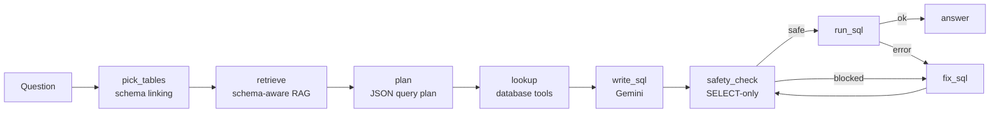

# Agentic Text-to-SQL Analytics Engine


A LangGraph agent that turns natural-language questions into **correct, safe PostgreSQL** over a real e-commerce database — with schema linking, schema-aware retrieval, a query planner that grounds filters against live data, self-correction, and a full LLMOps evaluation harness.

Built and evaluated on the [Olist Brazilian E-Commerce dataset](https://www.kaggle.com/datasets/olistbr/brazilian-ecommerce) (9 tables, ~100k orders).

> **Headline result:** **89.3%** execution accuracy (strict) / **96.4%** (result-set match) across a **150-question benchmark**, and **89.7%** on 26 held-out questions the agent was never tuned on, at **100% first-attempt query validity**.

---

## Quick example

**Question**

> *"What share of total revenue came from customers in the state of São Paulo (SP)?"*

**SQL the agent generates**

```sql
SELECT ROUND(
    (SUM(CASE WHEN c.customer_state = 'SP' THEN oi.price ELSE 0 END)
     * 100.0 / SUM(oi.price))::numeric, 2) AS sp_revenue_share
FROM order_items oi
JOIN orders o ON o.order_id = oi.order_id
JOIN customers c ON c.customer_id = o.customer_id;
```

**Answer** → `38.28` (%)

The agent decided which tables to join, followed the project's SQL conventions (revenue = item price, 2-decimal rounding, percentages on a 0–100 scale), and produced a query that ran first try. For questions where the wording doesn't match the stored data — e.g. *"the city of São Paulo"* when the database stores `sao paulo` — the **database-lookup tool** checks the real values first and grounds the query accordingly.

---

## Architecture

The agent is a **LangGraph** state machine. Each node does one job; the graph handles retries and the self-correction loop.



| Node | Role | LLM call? |
|---|---|---|
| **pick_tables** | Schema linking — selects the minimal set of relevant tables | yes |
| **retrieve** | Schema-aware RAG — top-3 example queries by embedding + table overlap | no (cached vectors) |
| **plan** | Produces a JSON query plan; its **filters** feed the lookup tool | yes |
| **lookup** | Database tools — validates each filter against the live schema and fetches real stored values | no (read-only SQL) |
| **write_sql** | Generates the PostgreSQL query from schema + examples + facts | yes |
| **safety_check** | Rejects anything that isn't a read-only `SELECT` | no |
| **run_sql** | Executes against PostgreSQL | no |
| **fix_sql** | Self-correction — feeds the Postgres error back to the model (max 2 attempts) | yes (only on error) |

~3 LLM calls per question.

---

## Key features

- **Schema linking** — an LLM table-picker, benchmarked against pure embedding retrieval (60/60 vs 57/60 table recall) and kept because it was more reliable.
- **Schema-aware RAG** — retrieves the 3 most relevant verified examples, scored by question similarity *plus* overlap with the question's tables. Cut prompt tokens 7–9% at equal accuracy.
- **Query planning → database tools** — the planner emits a structured JSON plan (output columns, filters, grouping). The plan's filters drive a **lookup tool** that validates `table.column` against the live schema and fetches real values (exact matches, nearest matches, date ranges) as grounding — all with bound parameters, read-only. This handles questions where the wording doesn't match the stored data.
- **Self-correction** — on a PostgreSQL error, the query and error are sent back to the model for up to 2 repair attempts.
- **Safety** — every generated query passes a SELECT-only gate before it touches the database.
- **Prompt rule system** — 12 house rules (rounding, duration-as-days, English category names, revenue vs payment definitions, etc.) enforced in the prompt and audited in every gold query.

> **Honest design note:** an earlier version let the planner also dictate the query's output columns. Measured against keep/drop criteria fixed *before* the experiment, it failed 3 of 4 (it added as many wrong columns as it fixed and broke one query's logic), so it was removed and the planner kept only as the filter source for the lookup tool. The evaluation harness recorded the decision with numbers rather than guesswork.

---

## Results

Final agent on the 150-question benchmark (3 runs each; strict = exact result match, subset = correct values allowing extra/re-ordered columns):

| Set | Questions | Strict | Subset | Query validity |
|---|---|---|---|---|
| Tuned | 60 | 83.9% | 98.3% | 100% |
| Variant | 20 | 90.0% | 95.0% | 100% |
| Extended | 44 | 96.2% | 97.0% | 100% |
| **Held-out (never seen)** | **26** | **89.7%** | 92.3% | 100% |
| **All** | **150** | **89.3%** | **96.4%** | **100%** |

The **held-out** set is the real generalisation measure: 26 fresh questions — including deliberately hard cases where the filter value differs from the stored data — written and frozen *after* the agent was finalised, leakage-checked against the training questions.

### LLMOps metrics (tracked per run)
- **Execution accuracy** — strict and subset (above)
- **Query validity** — 100% of first-attempt queries parsed and ran
- **Correction rate** — 0% (100% validity meant the self-correction loop was never needed on this benchmark; it is exercised in earlier development runs)
- **Latency** — ~16 s median per question
- **Token efficiency** — ~4,600 tokens per question (3 LLM calls)

---

## Tech stack

**Python** · **LangGraph** (agent orchestration) · **Google Gemini API** (`gemini-3.5-flash-lite` for generation, `gemini-embedding-001` for retrieval) · **PostgreSQL** · **SQLAlchemy** + **psycopg2** · **SQLGlot** (SQL parsing/validation) · **pandas** · **NumPy**

---

## Project layout

| File | Purpose |
|---|---|
| `agent.py` | The LangGraph agent and the resumable evaluation runner |
| `link_tables.py` | Schema-linking table picker |
| `retriever.py` | Schema-aware example retrieval |
| `plan.py` | JSON query planner |
| `db_tools.py` | Database-lookup tools (filter validation + value grounding) |
| `run_eval.py` | Prompt builders and the Gemini calls |
| `sql_safety.py` | Read-only SELECT guard |
| `compare_results.py` | Database connection + result comparison |
| `lenient_score.py` | Strict / lenient / subset scoring |
| `llmops_report.py` | Computes the five LLMOps metrics from saved runs |
| `benchmark_v2.json` | The 150-question benchmark (gold SQL, set labels) |
| `prompt_rules.txt` | The 12 SQL-convention rules |

---

## Setup

1. **Database** — load the Olist CSVs into a local PostgreSQL database named `olist`.
2. **Environment** — create a `.env` file:
   ```
   GEMINI_API_KEY=your_key_here
   DB_PASSWORD=your_postgres_password
   ```
3. **Dependencies**
   ```bash
   pip install -r requirements.txt
   ```
4. **Run the evaluation**
   ```bash
   python agent.py
   ```
5. **Generate the LLMOps report**
   ```bash
   python llmops_report.py
   ```

---

## How the benchmark was built

The 150 questions are split into tuned, variant, extended, and a fresh held-out set. Every gold query is:
- written to the 12 prompt rules,
- audited automatically (SQLGlot + rule checks) before use,
- run against the database to confirm it returns sensible rows,
- leakage-checked (embedding similarity + exact text/SQL) so the held-out set contains no near-duplicates of the training questions.

Each experiment was run 3× (mean and range reported), with keep/drop criteria fixed before the run — so every design decision in this project is backed by measurement, including the ones that were rejected.

---

## License

Released under the [MIT License](LICENSE).
